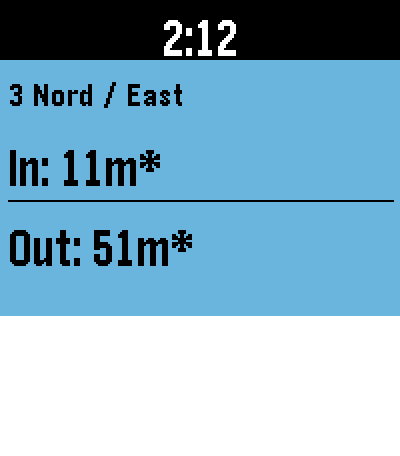
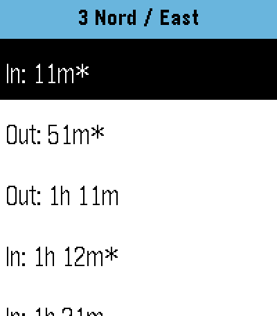

# B-Time

A Pebble smartwatch app for tracking nearby bus arrival times on **Butte Regional Transit (B-Line)** in Butte County, California.

| Nearby Routes | Upcoming Departures |
| :---: | :---: |
|  |  |

## Features

- **Nearby Routes**: Uses your phone's location to find B-Line routes nearby and shows the next **Inbound (`In`)** and **Outbound (`Out`)** departures for each route.
- **Real-Time & Scheduled Departures**: Displays countdowns (`Now`, `5m`, `1h 5m`) with a trailing `*` indicating live real-time estimates rather than scheduled times.
- **Soonest-First Ordering**: Automatically sorts routes so the soonest upcoming bus is always at the top.
- **Full Route Schedule View**: Press **Select** on any route to view up to 25 upcoming inbound and outbound departures for the day, combining live estimates with the published schedule.
- **Route Colors**: On color Pebble displays, routes and schedule headers are styled using official B-Line route colors with automatic legible text contrast.
- **Auto-Refresh**: Displays the current time (12h or 24h) in the header and refreshes nearby bus times every 30 seconds.

## Controls

| Button | Action |
| --- | --- |
| **Up / Down** | Scroll through nearby routes or upcoming departures |
| **Select** | Open the upcoming schedule for the highlighted route |
| **Back** | Return to the route list, or exit the app |

## Supported Platforms

B-Time builds for all Pebble SDK 3 platforms:

- **Aplite** (Pebble Classic / Steel)
- **Basalt** (Pebble Time / Time Steel)
- **Chalk** (Pebble Time Round)
- **Diorite** (Pebble 2)
- **Emery** (Pebble Time 2)
- **Flint** (Pebble 2 Duo)

## How It Works

- **`src/c/main.c`**: Native C watchapp handling the clock header, animated loading bar, route card list, route color styling, and schedule view over Pebble's `AppMessage` API.
- **`src/pkjs/index.js`**: PebbleKit JS companion running on the connected phone. It reads GPS coordinates via `navigator.geolocation` and queries the B-Line Plan My Ride API (`https://planmyride.blinetransit.com`) for nearby routes, next stop times, and stop schedules/estimates.

## Building & Installing

Requires the [Pebble SDK](https://developer.repebble.com/) (`pebble` CLI).

```bash
# Build the .pbw bundle for all platforms
pebble build

# Install on a physical watch via Developer Connection
pebble install --phone <PHONE_IP>

# Or run in an emulator (e.g. basalt, aplite, chalk, diorite, emery, flint)
pebble install --emulator basalt
```

> **Note:** Location access is required on the paired phone to find nearby B-Line stops.
